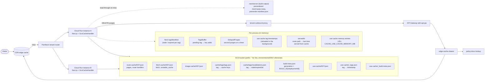
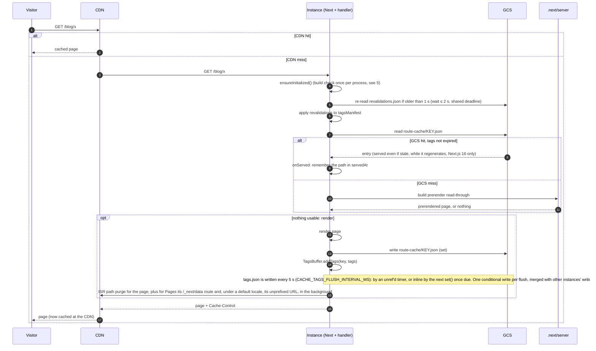
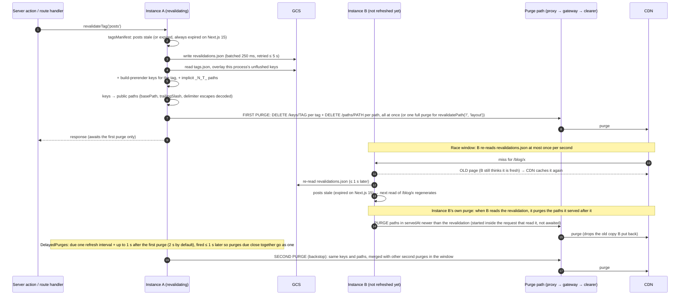
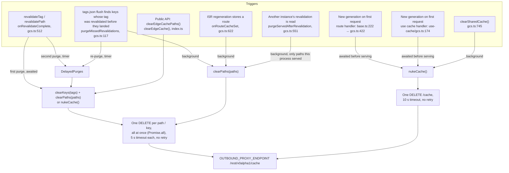
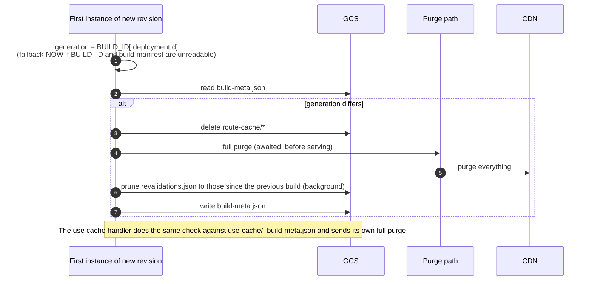

# How the cache is stored and invalidated (Next.js origin and CDN)

Scope: the GCS handlers (`src/handlers/gcs.ts`, `src/handlers/use-cache/gcs.ts`) and the edge
purge client (`src/edge/edge-cache-clear.ts`). The file handlers are not covered.

---

## 1. The pieces and where state lives

- Next's `tagsManifest` holds `{ stale, expired }` per tag on Next.js 16 and a single
  revalidation timestamp on Next.js 15, which has no stale-but-served state: every revalidation
  expires the tag at once. `src/utils/tags-manifest.ts` reads and writes whichever format the
  running Next.js uses; `revalidations.json` keeps the 16 shape on both, and an instance on 15
  applies an entry by its `expired` time, or its `stale` time when it has none.
- `servedAt` holds the public paths this process served from GCS entries, up to 5000 (the oldest
  are dropped first). Build-prerender hits are not recorded. Its only use is deciding which pages
  to purge when this process learns of another instance's revalidation (section 3).
- The `use cache` handler keeps entries it recently read or wrote in memory (LRU, 32 MB by
  default). A memory hit skips the GCS round trip but goes through the same tag and revalidate
  expiry checks.
- Build-time prerendered pages are not in GCS. They are served from `.next/server` when GCS
  misses (`base.ts:386`), and their tags are indexed per process from the build output
  (`loadBuildPrerenderTags`), never written to `tags.json`.
- The CDN caches whatever `Cache-Control` Next sends (for a static page, `s-maxage=31536000`). Only
  a purge makes it drop an entry. Nothing ties a CDN entry to the GCS entry it came from.

## 2. Serving and storing a page

## 3. `revalidateTag()` / `revalidatePath()` and the two CDN purges

Called from a server action, a route handler (for example a site's `/api/revalidate`), or
Next's `revalidatePath` (which revalidates the implicit `_N_T_<path>` tags).

When an instance learns of a revalidation made elsewhere (`SharedRevalidations.setOnLearned` →
`purgeServedAfterRevalidation`), it purges only the paths it served from its cache since that
revalidation, allowing 1 s of clock skew. An instance that served none of them sends nothing, and a
`revalidatePath('/', 'layout')` does not make every instance purge the whole site.

Unlike the second purge, this one needs no timer. It starts inside the request whose cache read
refreshed `revalidations.json`, so it has CPU, and that read does not wait for it to finish.
Revalidations that were already stored when an instance's first read of the object finishes are
skipped. That read usually completes before the instance serves anything, but not always: `get()`
stops waiting after `REFRESH_WAIT_MS` (2 s) and serves with what it has, and the read keeps going.
Pages served while it was in flight are skipped too. Pages served from the build prerenders in
`.next/server` are never in `servedAt`, so this purge misses them as well. Section 6 lists both
gaps.

What each step depends on:

| Step | Code | If it fails or is late |
|---|---|---|
| Store revalidation | `shared-revalidations.ts`, `base.ts:562` | Retried on later reads and at `flushSharedTagsMapping()`; the second purge waits for the store (`gcs.ts:546`). Other instances keep serving the old page until it lands. |
| Read tags map | `gcs.ts:309` | Logged; only this process's own keys and build prerenders are purged. |
| First purge | `gcs.ts:596` (`purgeTags`), `edge-cache-clear.ts:114` | One request per path, no retry. Inside the request, so it has CPU. |
| Purge by an instance that learned of it | `shared-revalidations.ts` (`notifyLearned`), `gcs.ts:551` | Logged, never rejects; one request per path, no retry. Skipped for revalidations found on the instance's first read, and never covers build-prerender hits. |
| Second purge | `gcs.ts:532-547`, `delayed-purges.ts` | On a timer: with request-based CPU it fires at the instance's next request; lost if the process stops first, unless the app calls `flushSharedTagsMapping()` (needs `NEXT_MANUAL_SIG_HANDLE`). |

Pages Router entries carry no tags (Next writes `x-next-cache-tags` only for App Router
pages and route handlers), so no tag finds them and these purges include no data routes or
unprefixed locale URLs. A Pages Router page is purged when it regenerates, by its ISR
purge (section 4).

`use cache` entries are invalidated separately: Next calls the `use cache` handler's `updateTags`
(Next.js 16) or `expireTags` (Next.js 15, which calls `updateTags`), which writes
`use-cache/_tags.json` timestamps (`use-cache/gcs.ts:590`). That handler sends no
CDN purges for tags; the route handler's purge above covers the pages.

Other instances' `use cache` reads see the invalidation two ways:

- `refreshTags()` reloads `_tags.json` in the background, at most once per
  `CACHE_TAGS_REFRESH_INTERVAL_MS`, and returns without waiting for GCS. Next awaits it inside a
  staged render whose static stage ends after one task. Waiting on GCS there would push every
  cached result out of the static stage, and the client could no longer reuse them.
- `invalidatedAt(tag)` also checks Next's `tagsManifest`, which the route handler fills from
  `revalidations.json`. It reads it through `src/utils/tags-manifest.ts`, so Next.js 15's
  timestamp entries count too. A render can't reuse a value older than a revalidation the process already
  knows of, even before the background reload finishes.

## 4. Everything that sends a CDN purge

Request shapes (`edge-cache-clear.ts`):

| Purge | Request | Encoding |
|---|---|---|
| Path | `DELETE /rest/v0alpha1/cache/paths/<seg>` | path without its leading `/`, `encodeURIComponent` twice (`node/998` → `node%252F998`; `/` → `%252F`) |
| Key (tag) | `DELETE /rest/v0alpha1/cache/keys/<seg>` | `encodeURIComponent` twice |
| Full | `DELETE /rest/v0alpha1/cache` | – |

Path requests per ISR regeneration (`onRouteCacheSet`, `gcs.ts:622`), one `DELETE` each:

| Entry | Paths purged | Requests |
|---|---|---|
| App Router page or route handler | the page (`/blog`) | 1 |
| Pages Router page | the page and its data route (`/_next/data/<buildId>/blog.json`) | 2 |
| Pages Router page under a default locale (`i18n`) | `/en/blog`, its data route, and `/blog`, where Next serves the default locale | 3 |

Without the data route, client-side navigation keeps getting the old props. Without the
unprefixed URL, the default locale's public URL keeps serving the old page.

Each path is named the way the CDN keys it: decoded (a cache key for `/what%3F` is purged
as `/what?`) and with the trailing slash Next serves. `clearEdgeCachePaths()` applies the
same trailing-slash rule to the paths a caller passes and also drops any query string or
fragment, since the CDN keys a page by its path alone.

What gets grouped today: paths are deduplicated per revalidation (`gcs.ts:582`) and per
`clearPaths` call, and second purges due within 1 s of each other are merged per target
(`delayed-purges.ts`). Nothing else is merged across calls. Nothing limits requests in
flight or per second either; per-tenant limits are left to the platform.

## 5. Deploys (new generation)

A process that falls back to `fallback-<Date.now()>` has a generation no other process shares,
so each such cold start would wipe `route-cache/` and fully purge the CDN.

## 6. Known gaps

| Gap | Effect | Where it is tracked |
|---|---|---|
| Second and background purges run on timers | Late under request-based CPU; lost on shutdown without `flushSharedTagsMapping()`. The purge each instance sends when it learns of a revalidation covers most of this | README "Revalidations across processes" |
| Revalidation first seen on an instance's first read of `revalidations.json` | That instance sends no purge for pages it served before, or while, its first read was in flight (`get()` serves after 2 s without waiting for the read to finish). Only the second purge covers them | – |
| Build-prerender hits are not recorded in `servedAt` | `onServed` runs only on the GCS-hit path in `base.ts:409`, not on the prerender return at `base.ts:388`. An instance that serves an old prerendered page before it learns of the revalidation skips that page in its own purge, and only the timer-based second purge covers it | – |
| `use cache` tag reload is background | A tag revalidated on another instance can be missed by this instance's `use cache` reads for up to about one refresh interval plus the reload's GCS round trip (see below) | README `CACHE_TAGS_REFRESH_INTERVAL_MS` |
| GCS stall longer than the second-purge delay | An instance still serving without the revalidation can re-cache the old page after the last purge | – |

More on the `use cache` gap. A read on this instance can return outdated data when all of these hold:

- Another instance revalidated the tag, for example `revalidateTag` from a server action or webhook.
- The render does not pass through the route handler first. ISR and PPR pages do: the route
  handler waits up to `REFRESH_WAIT_MS` (2 s, `src/handlers/gcs.ts`) for `revalidations.json` and
  copies it into `tagsManifest`, which `invalidatedAt()` checks. App route handlers that call
  `use cache` functions don't.
- This instance's `_tags.json` reload has not picked up the revalidation yet. `refreshTags()` starts
  a reload at most once per interval and returns at once, so requests before the next reload, and
  the ones that arrive while it runs, see the old timestamps.

It shows up most for popular entries, which tend to still be in memory. The reload itself is one or
two GCS round trips, usually tens of milliseconds. Awaiting it would fix this but push cached results
out of the static stage of cached navigations, which costs more than the short window.
