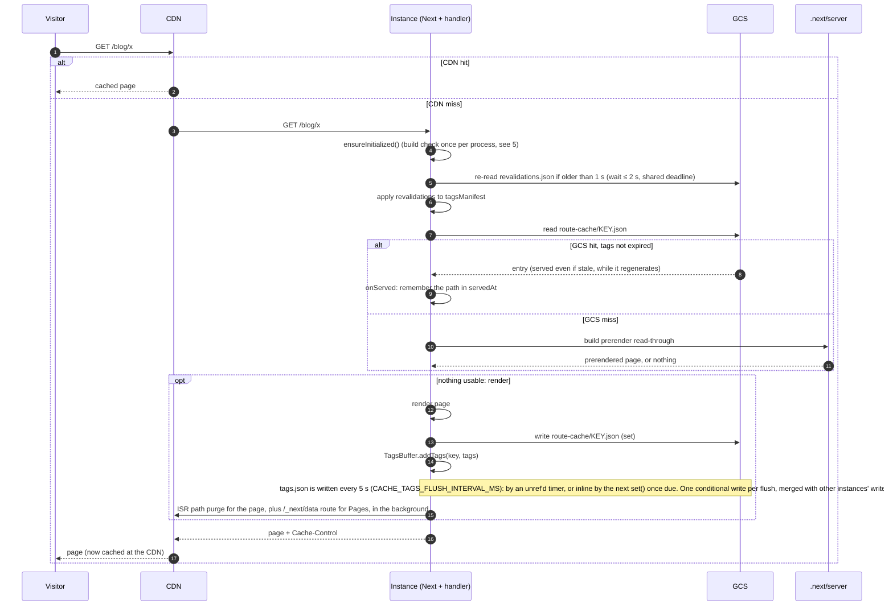
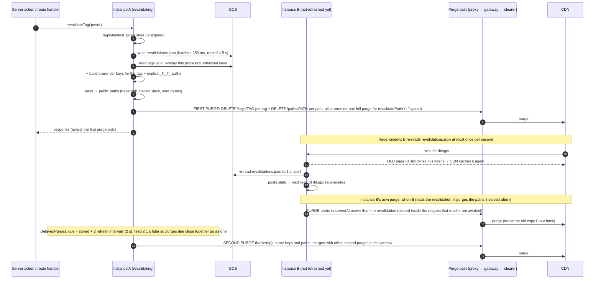
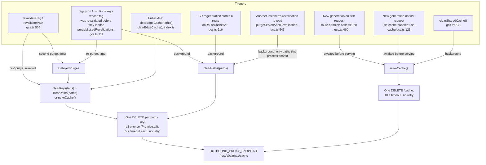
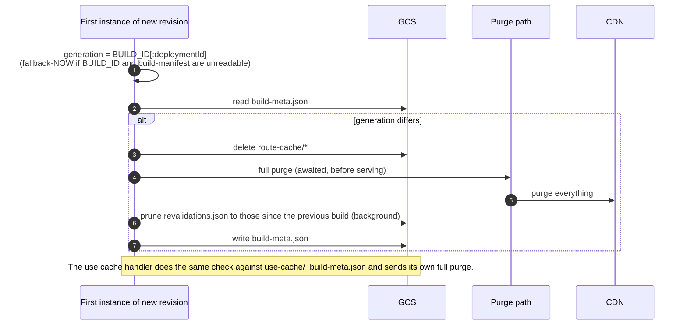

# How the cache is stored and invalidated (Next.js origin and CDN)

**Scope:** the GCS handlers (`src/handlers/gcs.ts`, `src/handlers/use-cache/gcs.ts`) and the edge
purge client (`src/edge/edge-cache-clear.ts`). The file handlers are not covered.

---

## 1. The pieces and where state lives

- `servedAt` records the public paths this process served from the cache (capped at 5000, oldest
  forgotten first). It is used only to decide which pages to purge after learning of another
  instance's revalidation (section 3).
- The `use cache` handler keeps recently read or written entries in memory (default 32 MB, LRU).
  A memory hit skips the GCS round trip but is checked against the same tag and revalidate expiry.
- Build-time prerendered pages are **not** in GCS. They are served from `.next/server` when GCS
  misses (`base.ts:385`), and their tags are indexed per process from the build output
  (`loadBuildPrerenderTags`), never written to `tags.json`.
- The CDN caches whatever `Cache-Control` Next sends (for a static page, `s-maxage=31536000`). It
  is told to drop entries only by purges; nothing ties a CDN entry to the GCS entry it came from.

## 2. Serving and storing a page

## 3. `revalidateTag()` / `revalidatePath()` and the two CDN purges

Called from a server action, a route handler (for example a site's `/api/revalidate`), or
Next's `revalidatePath` (which revalidates the implicit `_N_T_<path>` tags).

An instance that learns of a revalidation another instance made (`SharedRevalidations.setOnLearned` →
`purgeServedAfterRevalidation`) purges only the paths it served from its cache after that
revalidation (1 s clock skew allowed), so an instance that served none sends no purge, and a
`revalidatePath('/', 'layout')` does not purge the whole site from every instance. It starts inside
the request whose cache read refreshed `revalidations.json`, which has CPU, and that read does not wait
for it. Revalidations already stored when an instance first reads the object are skipped, since it had
served nothing before then. This does not depend on a timer, unlike the second purge.

What each step depends on:

| Step | Code | If it fails or is late |
|---|---|---|
| Store revalidation | `shared-revalidations.ts`, `base.ts:562` | Retried on later reads and at `flushSharedTagsMapping()`; the second purge waits for the store (`gcs.ts:527-540`). Other instances keep serving the old page until it lands. |
| Read tags map | `gcs.ts:303` | Logged; only this process's own keys and build prerenders are purged. |
| First purge | `gcs.ts:527` (`purgeTags`), `edge-cache-clear.ts:114` | One request per path, no retry. Inside the request, so it has CPU. |
| Purge by an instance that learned of it | `shared-revalidations.ts` (`notifyLearned`), `gcs.ts:545` | Logged, never rejects; one request per path, no retry. Skipped for revalidations found on the instance's first read. |
| Second purge | `gcs.ts:527-540`, `delayed-purges.ts` | On a timer: with request-based CPU it fires at the instance's next request; lost if the process stops first, unless the app calls `flushSharedTagsMapping()` (needs `NEXT_MANUAL_SIG_HANDLE`). |

`use cache` entries are invalidated separately: Next calls the `use cache` handler's `updateTags`,
which writes `use-cache/_tags.json` timestamps (`use-cache/gcs.ts:581`). That handler sends no
CDN purges for tags; the route handler's purge above covers the pages.

Other instances' `use cache` reads see the invalidation two ways:

- `refreshTags()` reloads `_tags.json` in the background, at most once per
  `CACHE_TAGS_REFRESH_INTERVAL_MS`. It does not wait for GCS: Next awaits it inside a staged render
  whose static stage ends after one task, and a GCS wait would push every cached result out of that
  stage so the client could not reuse it.
- `invalidatedAt(tag)` also consults Next's `tagsManifest`, which the route handler fills from
  `revalidations.json`, so a render cannot reuse a value older than a revalidation the process
  already knows of, without waiting for the background reload.

## 4. Everything that sends a CDN purge

Request shapes (`edge-cache-clear.ts`):

| Purge | Request | Encoding |
|---|---|---|
| Path | `DELETE /rest/v0alpha1/cache/paths/<seg>` | path without its leading `/`, `encodeURIComponent` twice (`node/998` → `node%252F998`; `/` → `%252F`) |
| Key (tag) | `DELETE /rest/v0alpha1/cache/keys/<seg>` | `encodeURIComponent` twice |
| Full | `DELETE /rest/v0alpha1/cache` | – |

Grouping that exists today: paths are a set per revalidation (`gcs.ts:576`) and per
`clearPaths` call; second purges due within 1 s are merged per target
(`delayed-purges.ts`). Nothing else is merged across calls, and nothing limits requests in
flight or per second; per-tenant limits are left to the platform.

## 5. Deploys (new generation)

A process that falls back to `fallback-<Date.now()>` has a generation no other process shares,
so each such cold start would wipe `route-cache/` and fully purge the CDN.

## 6. Known gaps

| Gap | Effect | Where it is tracked |
|---|---|---|
| Second and background purges run on timers | Late under request-based CPU; lost on shutdown without `flushSharedTagsMapping()` | README "Revalidations across processes" |
| Revalidation first seen on an instance's first read of `revalidations.json` | That instance sends no purge for pages it may have served before the read | – |
| `use cache` tag reload is background | A tag revalidated elsewhere reaches this instance's `use cache` reads within about one refresh interval (route handler revalidations apply at once via `tagsManifest`) | README `CACHE_TAGS_REFRESH_INTERVAL_MS` |
| GCS stall longer than the second-purge delay | An instance still serving without the revalidation can re-cache the old page after the last purge | – |
