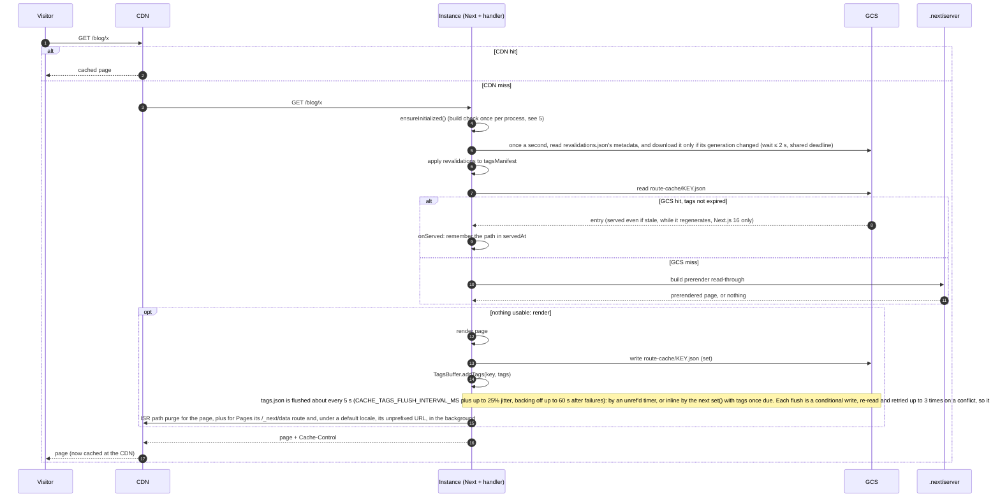
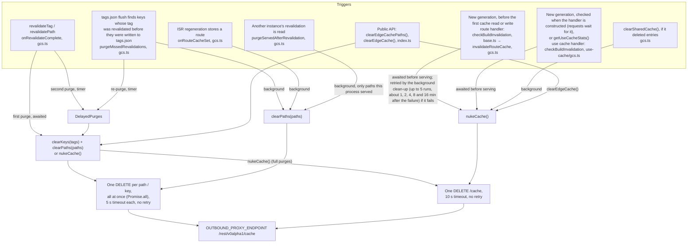

# How the cache is stored and invalidated (Next.js origin and CDN)

Scope: the GCS handlers (`src/handlers/gcs.ts`, `src/handlers/use-cache/gcs.ts`) and the edge
purge client (`src/edge/edge-cache-clear.ts`). The file handlers are not covered.

---

## 1. The pieces and where state lives

```mermaid
flowchart LR
  visitor([Visitor]) --> cdn[(CDN edge cache)]
  cdn -- "miss" --> router[Pantheon tenant router]
  router --> inst1["Cloud Run instance A<br/>Next.js + GcsCacheHandler"]
  router --> inst2["Cloud Run instance B<br/>Next.js + GcsCacheHandler"]

  subgraph proc["Per process (in memory)"]
    manifest["Next tagsManifest<br/>(stale / expired per tag)"]
    buffer["TagsBuffer<br/>pending tag → key adds"]
    delayed["DelayedPurges<br/>second purges on a timer"]
    tagts["use cache tag timestamps<br/>(reloaded in the background)"]
    served["servedAt<br/>route path → last time served from cache"]
    ucmem["use cache memory entries<br/>LRU, CACHE_USE_CACHE_MEMORY_MB"]
  end
  inst1 -.-> proc

  subgraph gcs["GCS bucket (prefix: '' for live or when PANTHEON_ENVIRONMENT is unset, environments/ENV/ otherwise)"]
    route["route-cache/KEY.json<br/>pages, route handlers<br/>stamped with their generation"]
    fetchc["fetch-cache/KEY.json<br/>fetch, unstable_cache"]
    image["image-cache/KEY.json"]
    tags["cache/tags/tags.json<br/>tag → cache keys"]
    reval["cache/tags/revalidations.json<br/>tag → stale/expired/at"]
    meta["build-meta.json<br/>generation = BUILD_ID[:deploymentId]"]
    uc["use-cache/KEY.json"]
    ucTags["use-cache/_tags.json<br/>tag → timestamp"]
    ucMeta["use-cache/_build-meta.json"]
  end
  inst1 --> gcs
  inst2 --> gcs

  build[".next (build output)<br/>server/: prerendered .html/.body/.meta<br/>prerender-manifest.json"]
  inst1 -. "read-through on miss" .-> build

  inst1 -- "DELETE purges" --> proxy[tenant-outbound-proxy]
  proxy --> gw[API Gateway edrt-api-gw]
  gw --> clearer[edge-cache-clearer]
  clearer --> policy[policy-docs lookup]
  clearer --> cdn
```



- Next's `tagsManifest` holds `{ stale, expired }` per tag on Next.js 16 and a single
  revalidation timestamp on Next.js 15, which has no stale-but-served state: every revalidation
  expires the tag at once. `src/utils/tags-manifest.ts` reads and writes whichever format the
  running Next.js uses; `revalidations.json` keeps the 16 shape on both, and an instance on 15
  applies an entry by the later of its `stale` and `expired` times that has passed, or by `stale`
  when neither has (a soft revalidation from 16 keeps the tag's earlier `expired`). A time still
  ahead of this instance's clock is recorded as now: Next.js 15 expires every entry older than
  the timestamp, with no check that it has passed. A time older than the one recorded leaves the
  recorded one in place, so entries it expired stay expired.
- `get()` returns a miss for an entry carrying a tag that expired after the entry was written (on
  Next.js 16 a soft `revalidateTag(tag, profile)` only marks it stale, and the entry is served
  while it regenerates). For
  pages, route handlers and Pages Router entries the tags come from the entry. For `fetch` and
  `unstable_cache` entries on Next.js 15 they are the fetch's tags plus the requesting route's
  implicit tags, from `ctx`. Next.js 16 checks fetch entries itself, but Next.js 15 leaves that
  to the FileSystemCache this handler replaces.
- `servedAt` holds the public paths this process served from GCS entries, up to 5000 (the oldest
  are dropped first). It is filled only when `OUTBOUND_PROXY_ENDPOINT` is set, and never for
  images or build-prerender hits. Its only use is deciding which pages to purge when this process
  learns of another instance's revalidation (section 3).
- The `use cache` handler keeps entries it recently read or wrote in memory (LRU, 32 MB by
  default). A memory hit skips the GCS round trip but goes through the same tag and revalidate
  expiry checks.
- Build-time prerendered pages are not in GCS. They are served from `.next/server` when GCS
  misses (`getBuildPrerender` in `base.ts`), and their tags are indexed per process from the build output
  (`loadBuildPrerenderTags`), never written to `tags.json`.
- The CDN caches whatever `Cache-Control` Next sends (for a static page, `s-maxage=31536000`); the
  handler never changes that header. Before its `s-maxage` runs out, only a purge makes the CDN
  drop an entry. A CDN entry is not linked to the GCS entry it came from.
- `KEY` in an object name is the cache key itself when it has only `[a-zA-Z0-9-]` (fetch and image
  keys) and at most 200 characters. Any other key is sanitized to those characters, cut to fit,
  and suffixed with `_` and a hash of the full key (`src/utils/object-names.ts`), so keys that
  sanitize or cut alike still get their own objects. 200 keeps file names under the 255-byte limit
  most file systems set.

## 2. Serving and storing a page



## 3. `revalidateTag()` / `revalidatePath()` and the two CDN purges

Called from a server action, a route handler (for example a site's `/api/revalidate`), or
Next's `revalidatePath` (which revalidates the implicit `_N_T_<path>` tags).

```mermaid
sequenceDiagram
  autonumber
  participant Caller as Server action / route handler
  participant A as Instance A (revalidating)
  participant G as GCS
  participant B as Instance B (not refreshed yet)
  participant P as Purge path (proxy → gateway → clearer)
  participant CDN

  Caller->>A: revalidateTag('posts')
  A->>A: tagsManifest: posts stale (or expired, always expired on Next.js 15)
  A->>G: write revalidations.json (batched 250 ms, retried ≤ 5 s)
  A->>G: read tags.json, overlay this process's unflushed keys
  A->>A: + build-prerender keys for the tag, + implicit _N_T_ paths
  A->>A: keys → public paths (basePath, trailingSlash, delimiter escapes decoded)
  A->>P: FIRST PURGE: DELETE /keys/TAG per tag + DELETE /paths/PATH per path, all at once (for revalidatePath('/', 'layout'): the key DELETEs plus one full purge instead of the paths)
  P->>CDN: purge
  A-->>Caller: response (after the revalidations.json store, up to about 5 s, the tags.json read and the first purge, not the second purge)

  Note over B,CDN: Race window: B re-reads revalidations.json at most once per second
  CDN->>B: miss for /blog/x
  B-->>CDN: OLD page (B still thinks it is fresh) → CDN caches it again

  B->>G: re-read revalidations.json (≤ 1 s later)
  B->>B: posts stale (expired on Next.js 15) → next read of /blog/x regenerates

  Note over B,CDN: Instance B's own purge: when B reads the revalidation, it purges the paths it served after it
  B->>P: PURGE paths in servedAt newer than the revalidation (started inside the request that read it, not awaited)
  P->>CDN: purge (drops the old copy B put back)

  Note over A: DelayedPurges: due one refresh interval + up to 1 s after the first purge (2 s by default); the timer fires 1 s after the earliest due one and sends every purge due by then, so purges due close together go as one
  A->>P: SECOND PURGE (backstop): same keys and paths, merged with other second purges in the window
  P->>CDN: purge
```

When an instance learns of a revalidation made elsewhere (`SharedRevalidations.setOnLearned` →
`purgeServedAfterRevalidation`), it purges only the paths it served from its cache since that
revalidation, allowing 1 s of clock skew. An instance that served none of them does not send a purge, and a
`revalidatePath('/', 'layout')` does not make every instance purge the whole site.

Unlike the second purge, this one needs no timer. It usually starts inside the request whose cache
read refreshed `revalidations.json`, so it has CPU, and that read does not wait for it to finish.
It can also start from this instance's own `revalidations.json` write, or from a `tags.json` flush
that runs on the buffer's timer.
Revalidations that were already stored when an instance's first read of the object finishes are
skipped. That read usually completes before the instance serves anything, but not always: `get()`
stops waiting after `REFRESH_WAIT_MS` (2 s) and serves with what it has, and the read keeps going.
Pages served while it was in flight are skipped too. Pages served from the build prerenders in
`.next/server` are never in `servedAt`, so this purge misses them as well. Section 6 lists both
gaps.

What each step depends on:

| Step | Code | If it fails or is late |
|---|---|---|
| Store revalidation | `shared-revalidations.ts`, `revalidateTag` in `base.ts` | Retried on later reads and at `flushSharedTagsMapping()`; the second purge waits for the store (`whenStored` in `onRevalidateComplete`, `gcs.ts`). Other instances keep serving the old page until the store succeeds. |
| Read tags map | `readTagsMapping` in `gcs.ts` | Logged; the tags, the implicit `_N_T_` paths, this process's own keys and build prerenders are still purged, but keys only other instances flushed are missed. |
| First purge | `purgeTags` in `gcs.ts`, `clearPaths` and `clearKeys` in `edge-cache-clear.ts` | One request per path, no retry. Inside the request, so it has CPU. |
| Purge by an instance that learned of it | `shared-revalidations.ts` (`notifyLearned`), `purgeServedAfterRevalidation` in `gcs.ts` | Logged, never rejects; one request per path, no retry. Skipped for revalidations found on the instance's first read, and never covers build-prerender hits. |
| Second purge | `onRevalidateComplete` in `gcs.ts`, `delayed-purges.ts` | On a timer: with request-based CPU it fires at the instance's next request; lost if the process stops first, unless the app calls `flushSharedTagsMapping()` (needs `NEXT_MANUAL_SIG_HANDLE`). |

Pages Router entries carry no tags (Next writes `x-next-cache-tags` only for App Router
pages and route handlers), so no tag finds them and these purges include no data routes or
unprefixed locale URLs. A Pages Router page is purged when it regenerates, by its ISR
purge (section 4).

`use cache` entries are invalidated separately: Next calls the `use cache` handler's `updateTags`
(Next.js 16) or `expireTags` (Next.js 15, which calls `updateTags`), which writes
`use-cache/_tags.json` timestamps (`updateTags` in `use-cache/gcs.ts`). It ignores `durations`, so a soft
`revalidateTag(tag, profile)` expires `use cache` entries at once. That handler sends no
CDN purges for tags; the route handler's purge above covers the pages.

Other instances' `use cache` reads see the invalidation two ways:

- `refreshTags()` reloads `_tags.json` in the background, at most once per
  `CACHE_TAGS_REFRESH_INTERVAL_MS`, and returns without waiting for GCS. Next awaits it inside a
  staged render whose static stage ends after one task. Waiting on GCS there would push every
  cached result out of the static stage, and the client could no longer reuse them.
- `invalidatedAt(tag)` also checks Next's `tagsManifest`, which the route handler fills from
  `revalidations.json`. It reads it through `src/utils/tags-manifest.ts`, so Next.js 15's
  timestamp entries count too. A render can't reuse a value older than a revalidation the process already
  knows of, even before the background reload finishes.

## 4. Everything that sends a CDN purge



Request shapes (`edge-cache-clear.ts`):

| Purge | Request | Encoding |
|---|---|---|
| Path | `DELETE /rest/v0alpha1/cache/paths/<seg>` | path without its leading `/`, `encodeURIComponent` twice (`node/998` → `node%252F998`; `/` → `%252F`) |
| Key (tag) | `DELETE /rest/v0alpha1/cache/keys/<seg>` | `encodeURIComponent` twice |
| Full | `DELETE /rest/v0alpha1/cache` | – |

Path requests per ISR regeneration (`onRouteCacheSet` in `gcs.ts`), one `DELETE` each:

| Entry | Paths purged | Requests |
|---|---|---|
| App Router page or route handler | the page (`/blog`) | 1 |
| Pages Router page | the page and its data route (`/_next/data/<buildId>/blog.json`), the data route only when `.next/BUILD_ID` is readable | 2 |
| Pages Router page under a default locale (`i18n`) | `/en/blog`, its data route, and `/blog`, where Next serves the default locale | 3 |

Without the data route, client-side navigation keeps getting the old props. Without the
unprefixed URL, the default locale's public URL keeps serving the old page.

Each path is named the way the CDN keys it: decoded (a cache key for `/what%3F` is purged
as `/what?`) and with the trailing slash Next serves. `clearEdgeCachePaths()` applies the
same trailing-slash rule to the paths a caller passes and also drops any query string or
fragment, since the CDN keys a page by its path alone.

What gets grouped today: paths are deduplicated per revalidation (`purgeTarget` in `gcs.ts`) and per
`clearPaths` call, and second purges due within 1 s of each other are merged per target
(`delayed-purges.ts`). Other purges are not merged across calls, and requests in flight or per
second are not limited either; per-tenant limits are left to the platform.

## 5. Deploys (new generation)

```mermaid
sequenceDiagram
  autonumber
  participant N as Each process (once, before its first cache read or write)
  participant G as GCS
  participant P as Purge path
  participant CDN

  N->>N: generation = BUILD_ID[:deploymentId]<br/>(fallback-NOW if neither .next/BUILD_ID nor a build ID in .next/build-manifest.json is readable from the working directory)
  alt generation is fallback-*
    N->>N: warn and skip the check (it does not read, delete, purge or write anything)
  end
  N->>G: read build-meta.json
  alt generation differs (or the stored metadata is not valid JSON)
    N->>P: full purge (awaited, before serving)
    P->>CDN: purge everything
    N->>G: create route-cache-cleanup.json for this generation (conditional write; left alone if it is already this generation's, replaced if another's), noting a failed purge as purgePending, first retried 1 min later (on an existing job too, with a fresh count of retries). A job for this generation created before the replaced build was recorded was left by an earlier deploy of the same build (a rollback to a version that ignores the job, then a redeploy), and is replaced
    N->>G: prune revalidations.json to those since the previous build was built, deleting fetch-cache entries under the pruned tags first (background, skipped if the previous build-meta.json has no builtAt)
    N->>G: write build-meta.json
  else build-meta.json missing
    N->>G: write build-meta.json (no wipe, no purge)
  else build-meta.json cannot be read
    N->>N: build-meta.json is not written; the next handler runs the check again
  end
  Note over N: Requests are served from here on. The rest runs in the background, after a new generation and on every start whose generation is current (and again at most once a minute on route-cache reads)
  opt route-cache-cleanup.json exists for this generation, and its lock is free or expired
    N->>G: take the lock (conditional write: owner, expiresAt = now + 60 s), read it back
    N->>P: full purge again if purgePending and purgeRetryAt has passed (1 min after the failed purge, then 1, 2, 4 and 8 min after each failed retry; a job with only the purge left is not locked until then); give up with an error after 5 runs that tried; an instance without OUTBOUND_PROXY_ENDPOINT drops it with a warning
    N->>G: delete route-cache/* one listed page (1,000) at a time from the recorded cursor, at most CACHE_INVALIDATION_DELETE_CONCURRENCY (50) in flight, skipping objects stamped with this generation; each delete has ifGenerationMatch on the listed version. Skipped with CACHE_BUILD_INVALIDATION=off
    N->>G: after each page is listed (before its deletes) and after each page is done, stop if the job's GCS generation changed or the job is gone (taken over, finished, or replaced by a newer deploy), unless it is still this generation's job (another instance noted a failed purge on it: kept, and the job stays owed for a later run). A newer deploy replaces the job before any of its instances serves, so a listed page holding its entries is not deleted from. Every 15 s, also checked after each batch of deletes, renew the lock and record the cursor and totals; at most every 5 min, log the progress
    N->>G: unless route-cache-cleanup-removals.json already holds this job's removals (same generation and job createdAt; an earlier run stopped part-way), read tags.json's route keys (starting with /), list route-cache/ again, and as each page arrives decide to remove the keys whose object is not this generation's; fetch keys stay. Save the decisions, with each object's GCS generation at the time, to route-cache-cleanup-removals.json, written only over the version read at the start of the prune; if another run of this job saved its decisions first, use those, whose removals may already be stored
    N->>G: queue the removals through the tags buffer and flush; they count as stored when no tags.json write failed during the flush and no updates were dropped (removals whose write fails are unqueued, so no later write stores them). Once stored, list route-cache/ again and add back, with the tags each entry holds, the removed keys whose object is now this generation's or has a different GCS generation than at the decision (cached after its key was decided, by this build or by a newer one that replaced the job), and flush. A run that loses the job after its removals are stored still adds back before stopping, since its removals may have been written to tags.json after the new holder's add-back. A run that stops before the add-back is stored leaves the saved removals for the next run. Once the job is marked pruned, route-cache-cleanup-removals.json is deleted if it still holds this job's removals, at the GCS generation read
    N->>G: delete route-cache-cleanup.json (ifGenerationMatch) and log the totals, or, if the purge is still owed, release the lock and leave the job for a later run
  end
  Note over N,G: The use cache handler checks use-cache/_build-meta.json when it is constructed and sends its own full purge, so a process that starts before both metadata files record the new build sends two full purges (_build-meta.json is rewritten right after its purge, so its window is shorter). Unlike the route handler it has no fallback-* skip, so a process whose build ID can't be read purges the whole CDN on every start and on every getUseCacheStats() call. It deletes no entries (each records its generation, and one from another generation is deleted when read), rewrites _build-meta.json on every start, and retries the check on its next read or write when the file cannot be read.
```

The check runs once per process, and any difference counts as a new generation, not only a newer
one. Every process that starts before `build-meta.json` holds its generation purges and creates
the job (the second finds it already there). Only the one holding the job's lock deletes. A
process that dies after the purge but before `build-meta.json` is written leaves the new build
undetected, so the next process purges again; one that dies after leaves the job, which a later
instance resumes once the lock expires.
While two revisions serve at once (a rollout, a traffic split, a rollback), a cold start on either
one purges the CDN, replaces the job with its own generation's and writes its own generation back;
the instance working on the other generation's job stops before it deletes from the next page it lists. Neither revision
serves the other's route entries (each is stamped with its generation), so the two overwrite each
other's entries instead and miss more often until one revision is left. Old-revision instances can
still serve old pages that the CDN caches after the new revision's purge. A revision older than
0.14.0 ignores the job and deletes all of `route-cache/` before serving, as before.

A process that falls back to `fallback-<Date.now()>` has a generation no other process shares,
so each such cold start would fully purge the CDN and start a clean-up of `route-cache/`. The check is skipped
for such a generation instead, with a warning, and `build-meta.json` is left as it is. Such a
process can't detect a deploy, and it serves route entries whatever generation they carry (its own
is unique, so it would otherwise never hit).

## 6. Known gaps

| Gap | Effect | Where it is tracked |
|---|---|---|
| Second and background purges run on timers | Late under request-based CPU; lost on shutdown without `flushSharedTagsMapping()`. Even with it, a second purge whose revalidation is stored only during the flush is sent only if the purge flush has not yet taken its batch; otherwise it stays on the unref'd timer and is lost. A `tags.json`-flush purge (`purgeMissedRevalidations`) that is already due is started but not awaited. The purge each instance sends when it learns of a revalidation covers most of this | README "Revalidations across processes" |
| Revalidation first seen on an instance's first read of `revalidations.json` | That instance sends no purge for pages it served before, or while, its first read was in flight (`get()` serves after 2 s without waiting for the read to finish). Only the second purge covers them | – |
| Build-prerender hits are not recorded in `servedAt` | `onServed` runs only on the GCS-hit path of `get()` in `base.ts`, not when it returns a build prerender. An instance that serves an old prerendered page before it learns of the revalidation skips that page in its own purge, and only the timer-based second purge covers it | – |
| `use cache` tag reload is background | A tag revalidated on another instance can be missed by this instance's `use cache` reads for up to about one refresh interval plus the reload's GCS round trip (see below) | README `CACHE_TAGS_REFRESH_INTERVAL_MS` |
| GCS stall longer than the second-purge delay | An instance still serving without the revalidation can re-cache the old page after the last purge | – |
| Route-cache delete fails part-way | Deletes that still fail after their retry are counted and logged when the job finishes (counts by status, the fix); the next deploy deletes them. A listing that still fails releases the lock with the cursor, and a later instance resumes. Objects left over are never served, since their generation stamp differs, but take up storage meanwhile; with a permission problem every deploy fails the same way | – |
| Route keys added back after the prune | An entry that can't be read when its key is added back is logged as a warning, and a later run does not retry it. Until that page is cached again, revalidating its tags does not purge it from the CDN. An add-back that is not stored stops the run, and the next run retries it from the saved removals | – |
| Route keys missing during the prune | The prune runs while the new build serves. A key whose page the new build cached after its removal was decided is out of `tags.json` from when the removals are stored until the add-back listing of `route-cache/` reaches it and is flushed, which with a large bucket or throttled CPU can take minutes. Revalidating its tags meanwhile purges the tags as CDN keys but not that page's path | – |
| Prune holder replaced mid-prune | A holder that stalls past the 60 s lock while writing its removals can store them after the new holder added keys back. It adds back itself before stopping; if that listing fails or the process stops first, those pages lose their keys until cached again | – |
| Background delete under request-based CPU | Cloud Run throttles CPU between requests, so the delete only moves forward while requests arrive. On a site that scales to zero the job waits for the next request; old objects take up storage meanwhile, but are not served | – |
| Clean-up totals after a crash | A run that stops without releasing the lock (process killed) loses the counts since its last renewal, about 15 s of work, so the final totals undercount deletes | – |
| A failed prune write also unqueues requests' removals | When a `tags.json` write carrying the prune's removals fails, the prune unqueues its removals. A request's own removal of the same key, queued in the same process, is unqueued with them, so that key stays in `tags.json` pointing at a deleted entry. Revalidating its tags then sends one extra purge for that path | – |
| Clean-up lists `route-cache/` three times | The delete, the prune's decisions and the add-back each list every object. The deletes take most of the run time, but under throttled CPU each listing adds to how long the lock must be held | – |
| `build-meta.json` write fails | The check is retried by the next handler, so each request purges the CDN again (the job already exists, so the delete is not started again) until a write succeeds. The clean-up then starts only from route-cache reads, at most once a minute | – |
| Two revisions serving at once | Cold starts on either revision replace the clean-up job and fully purge in turn, so each deletes the other's entries and the CDN can cache old instances' pages after the new revision's purge (section 5) | – |
| GCS read and write failures | A failed read is a silent miss, so the page is served from its build prerender if it has one, and re-rendered otherwise. A failed write is logged, but `set()` still records the tags and sends the ISR purge for an entry that was not stored | – |
| Pending `tags.json` additions dropped | After 10 minutes of failed flushes, or at shutdown without `flushSharedTagsMapping()`, the keys are dropped and later revalidations of their tags don't purge those pages | README "How the mapping is written to GCS" |
| `tags.json` loses route keys only at a deploy | Within one build, every URL cached adds keys (including junk URLs and case variants), so the object grows until the next deploy, and every revalidation downloads all of it | – |
| Build ID unreadable (`fallback-*`) | The route handler skips the build check (warning on every start): a deploy neither deletes nor purges for it, and it serves route entries from any generation. The `use cache` handler has no such skip: it purges the whole CDN and rewrites `_build-meta.json` on every start and `getUseCacheStats()` call, and other processes delete its entries when they read them | – |
| `revalidations.json`, `use-cache/_tags.json` keep growing | `revalidations.json` is pruned only at a deploy, and never when the previous build recorded no `builtAt`. `_tags.json` and each process's tag timestamps are never pruned. Old-generation `use cache` objects are deleted only when read | README "How long revalidations are kept" (revalidations.json only) |
| `use cache` tag write fails | `updateTags()` still resolves. The retry runs on an unref'd timer that `flushSharedTagsMapping()` does not flush, so it can be late or lost | – |
| Some full-purge failures leave no trace | `nukeCache()` does not log, and the full purge for `revalidatePath('/', 'layout')` and second full purges ignore its result | – |
| Learned-revalidation purge limits | Needs `OUTBOUND_PROXY_ENDPOINT` (no `servedAt` otherwise) and forgets paths past the 5000 most recent. For `revalidatePath('/', 'layout')` it can send one `DELETE` per remembered path, all at once | – |
| `clearSharedCache()` | Purges the CDN only if it deleted entries. It deletes `tags.json` while the static-route entries it keeps stay, so revalidations no longer find them. It leaves `use-cache/` and `revalidations.json` | – |

More on the `use cache` gap. A read on this instance can return outdated data when all of these hold:

- Another instance revalidated the tag, for example `revalidateTag` from a server action or webhook.
- The render makes no read through the route cache handler. Any `get()` there (a static or ISR
  page or route handler, a cached `fetch`) waits up to `REFRESH_WAIT_MS` (2 s,
  `src/handlers/gcs.ts`) for `revalidations.json` and copies it into `tagsManifest`, which
  `invalidatedAt()` checks. A dynamic page or route handler whose only caching is `use cache`
  makes no such read.
- This instance's `_tags.json` reload has not picked up the revalidation yet. `refreshTags()` starts
  a reload at most once per interval and returns at once, so requests before the next reload, and
  the ones that arrive while it runs, see the old timestamps.

It shows up most for popular entries, which tend to still be in memory. The reload itself is one or
two GCS round trips, usually tens of milliseconds. Awaiting it would fix this but push cached results
out of the static stage of cached navigations, which costs more than the short window.
